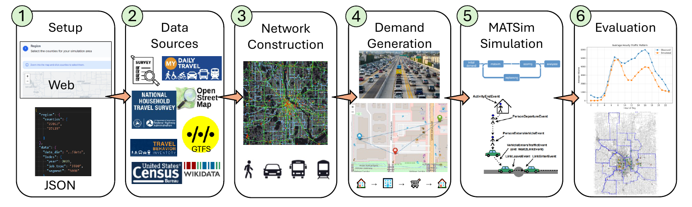
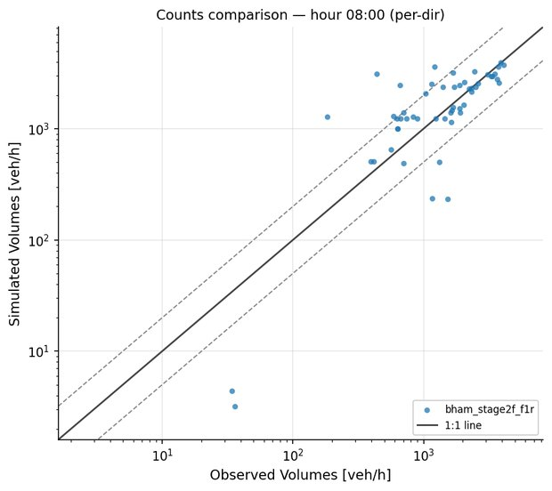
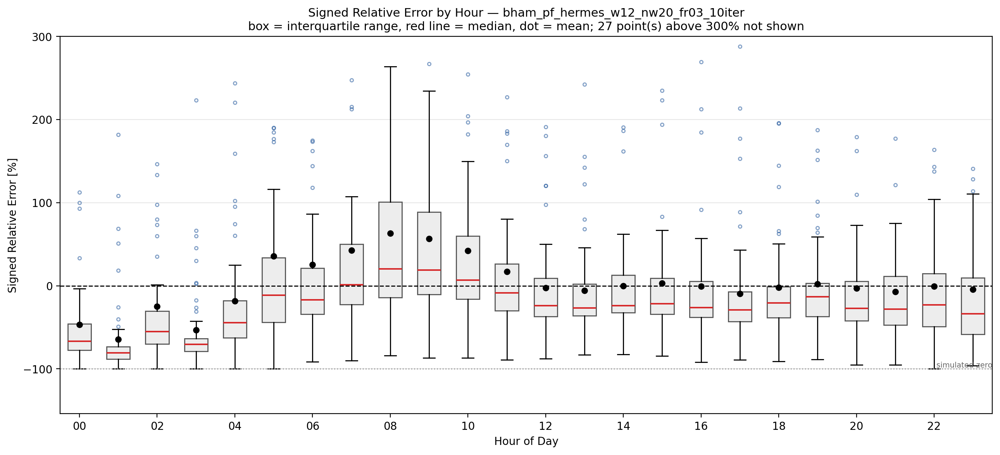
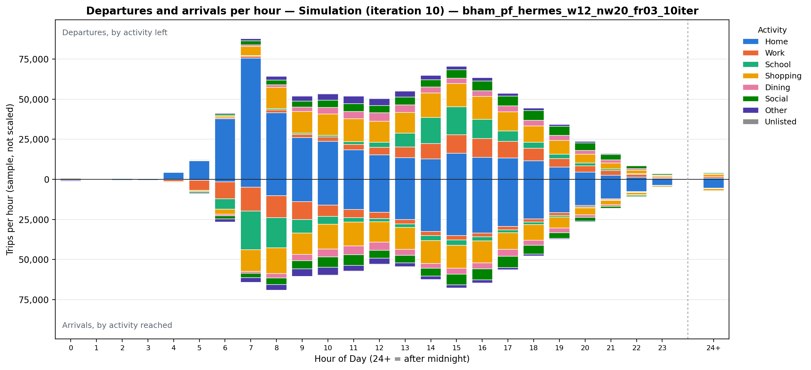
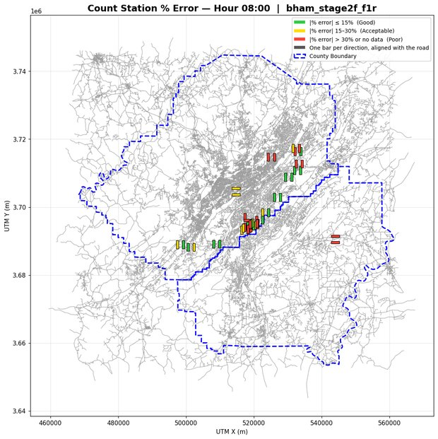
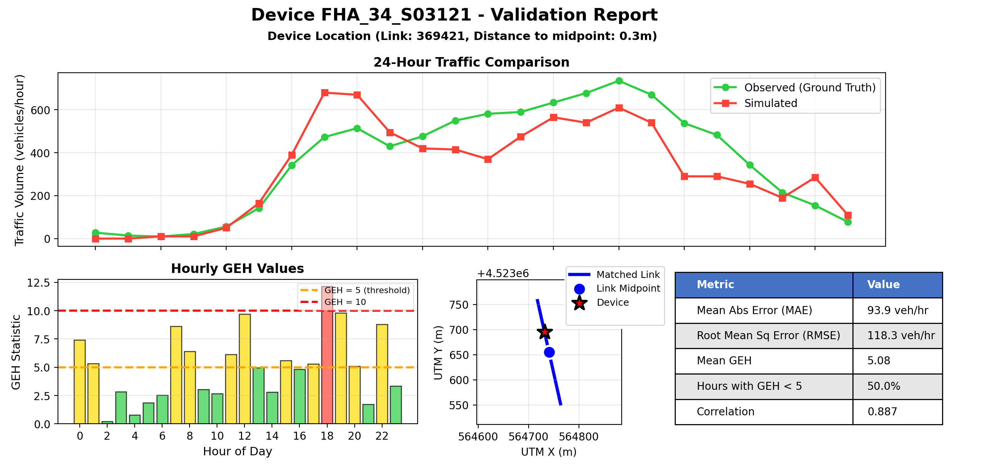
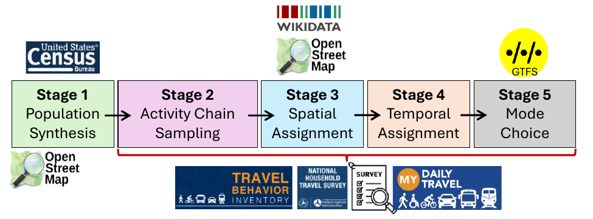
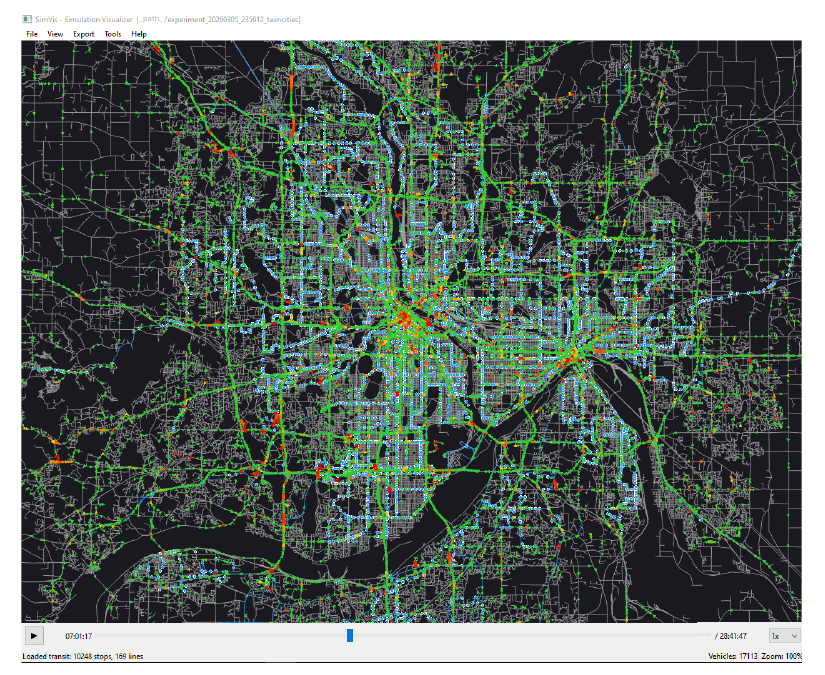
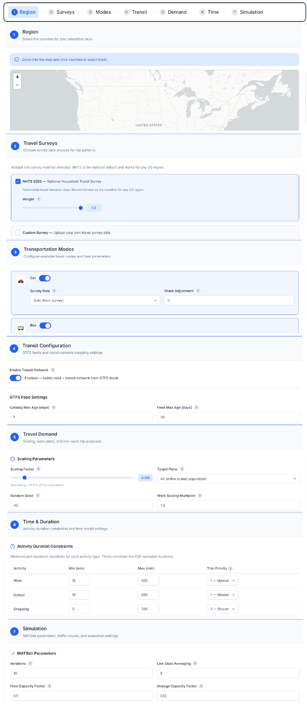

# TAREEK

**Build an agent-based traffic simulation for any U.S. region from a list of county codes.**

TAREEK (from Arabic *tarīq*, "road" or "path") is an open-source travel demand model for
[MATSim](https://matsim.org/). You give it a set of U.S. county FIPS codes. It then does
all the steps for you:

1. It downloads Census, employment, and road network data.
2. It finds and adds the transit feeds (GTFS) for the region.
3. It makes a synthetic population, with a full daily activity plan for each person.
4. It runs the MATSim simulation.
5. It compares the simulated traffic with national traffic count stations.

TAREEK uses only open data. You do not have to write code or prepare data by hand.



*The six stages of TAREEK: (1) you select the region in the web app or in a JSON file,
(2) TAREEK gets the data sources, (3) builds the road and transit network, (4) generates
the travel demand, (5) runs MATSim, and (6) validates the result against traffic counts.*

---

## What you can do with TAREEK

When you have a baseline simulation for a region, you can change its inputs and run it
again. Some research directions and practical problems that TAREEK can help with:

- **What-if studies on the road network.** Close a road, add a lane, or change the speed
  or capacity of a link, then measure the effect on travel times and traffic volumes.
  Road closures are built in: see [What-If Scenarios](#what-if-scenarios-road-closures).
- **Transit planning.** Test a new or extended transit line, or a change in service, and
  see how mode shares and traffic change.
- **Congestion and bottleneck analysis.** Find the links that are congested at each hour
  of the day, for example in the morning and evening peaks.
- **Compare regions.** Use the same method for a small city and for a large metropolitan
  area, and compare the results directly.
- **Regions without a local travel survey.** TAREEK uses the national survey (NHTS) by
  default, so you can model a region that has no survey of its own.
- **Travel demand research.** Study how activity chains, departure times, activity
  durations, and destination choice affect the simulated traffic.
- **Calibration and validation methods.** Test methods that tune the model automatically
  (for example optimization or AI agents) against the built-in count validation.
- **Model extensions.** Add ride-hailing, shared mobility, or freight inside the region,
  which the current pipeline does not generate. (Freight that crosses the region boundary
  is built in, as an option.)
- **Teaching.** Show students a complete agent-based simulation of their own city.

---

## Quick start

### 1. Prerequisites

TAREEK needs three programs on your computer:

| Program | Version | Used for |
|---|---|---|
| Python | 3.12 or later | Runs TAREEK |
| Java | 25 | Runs the MATSim simulation (MATSim 2026.0) |
| `osmium-tool` | Any recent version | Makes the road network from OpenStreetMap |

Use **one** of the two options below. Option A works the same on Windows, macOS and Linux,
and we recommend it.

#### Option A: install all three with one command (easiest)

1. Install [Miniforge](https://conda-forge.org/download/):
   - **Windows:** download the `.exe` installer, run it, and keep the default settings.
   - **macOS/Linux:** open a terminal and run:

     ```bash
     curl -L -O "https://github.com/conda-forge/miniforge/releases/latest/download/Miniforge3-$(uname)-$(uname -m).sh"
     bash Miniforge3-$(uname)-$(uname -m).sh
     ```

     Accept the license. When it asks to initialize conda, type `yes`. Then close the
     terminal and open a new one.
2. Open **Miniforge Prompt** (Windows: find it in the Start menu). On macOS/Linux, use the
   new terminal.
3. Type this command and press Enter. When it asks `Proceed ([y]/n)?`, type `y`.

   ```bash
   conda create -n tareek -c conda-forge python=3.12 openjdk=25 osmium-tool git
   ```

   This also installs Git, which you use in [Setup](#2-setup).
4. Activate the new environment:

   ```bash
   conda activate tareek
   ```

   The start of the prompt line changes from `(base)` to `(tareek)`. Python, Java,
   osmium and Git are available only while `(tareek)` shows. Keep this prompt open and
   continue with [Setup](#2-setup). If you close it, open Miniforge Prompt again and type
   `conda activate tareek` again. You do not have to do `conda create` again.

#### Option B: install each program separately

Use this option if you already have Python or Java. On Windows, osmium-tool is available
only through conda, so Option A is less work there.

<details>
<summary>Python</summary>

1. Download Python 3.12 or later from [python.org/downloads](https://www.python.org/downloads/).
2. Run the installer. **Windows:** on the first screen, select **Add python.exe to PATH**,
   then click **Install Now**.
3. Open a new terminal and type `python --version` (macOS/Linux: `python3 --version`) to
   check the installation.

**Linux:** your system Python can be too old (for example, Ubuntu 22.04 has 3.10). On
Ubuntu 24.04 or later, run `sudo apt-get install python3 python3-venv`. On older systems,
use Option A.

</details>

<details>
<summary>Java</summary>

TAREEK uses MATSim 2026.0 by default, which needs **Java 25**.

1. Download the **Temurin 25 (LTS) JDK** installer from
   [adoptium.net](https://adoptium.net/temurin/releases/?version=25) (`.msi` for Windows,
   `.pkg` for macOS).
2. Run the installer. **Windows:** on the **Custom Setup** screen, make sure that **Add to
   PATH** is on (it is on by default). You do not have to edit the PATH by hand. **macOS:**
   the installer sets up `java` for you.
3. Open a new terminal and type `java -version` to check the installation. The first line
   must show version 25.

**Linux (Ubuntu 24.04):** `sudo apt-get install openjdk-25-jre-headless`.

You can keep another Java (for example Java 21) as the default `java`. TAREEK finds Java 25
in this order: the config key `matsim.java_executable`, the environment variable
`TAREEK_JAVA_25`, `java` on PATH, `JAVA_HOME`, and the usual Java folders (for example
`/usr/lib/jvm`). If it cannot find Java 25 or MATSim 2026.0, the run stops at the start
with an error message that tells you what to do.

Java must have the `jdk.compiler` module (all JDKs and Ubuntu `openjdk-25-jre-headless`
have it). At start, Java compiles `matsim/launcher/TareekController.java`. This launcher
replaces a MATSim 2026.0 check that stops all TAREEK configs (countsScaleFactor; fixed
after the release by MATSim PR #5016).

**MATSim 2025.0 (fallback).** Set `"version": "matsim_25"` in the `matsim` section of your
config. Change nothing else. MATSim 2025.0 is part of the repository and needs Java 21 or
newer (`sudo apt-get install openjdk-21-jre-headless`). Its `legHistogram.txt` values are
(iteration + 2) times too large (a MATSim 2025.0 bug); the experiment summary corrects them.

</details>

<details>
<summary>osmium-tool</summary>

- **Windows:** there is no installer for Windows. Use Option A.
- **macOS:** `brew install osmium-tool` (this needs [Homebrew](https://brew.sh))
- **Linux (Ubuntu/Debian):** `sudo apt-get install osmium-tool`
- **Linux (Fedora):** `sudo dnf install osmium-tool`

Type `osmium --version` to check the installation. For more information, see
[docs/osm-tools-installation.md](docs/osm-tools-installation.md).

</details>

If a program is missing, TAREEK stops before it downloads data and tells you what to install.

### 2. Setup

Open your prompt (Option A: **Miniforge Prompt** on Windows, a terminal on macOS/Linux).

**Option A:** activate the environment first. Git is in the `tareek` environment, so
`git` is not found until you activate it:

```bash
conda activate tareek
```

Get the code and go into its folder:

```bash
git clone --depth 1 https://github.com/jalal1/TAREEK.git
cd TAREEK
```

`--depth 1` downloads only the latest version of the files, without the full project
history. This makes the download much smaller. If you want to contribute changes, you
can get the full history later with `git fetch --unshallow`.

No Git? On the [GitHub page](https://github.com/jalal1/TAREEK), click
**Code → Download ZIP** and extract it. Then go into the folder, for example
`cd Downloads\TAREEK-main` (macOS/Linux: `cd ~/Downloads/TAREEK-main`).

Install the Python packages:

**Option A** (`(tareek)` must show at the start of the prompt line):

```bash
pip install -r requirements.txt
```

**Option B:**

```bash
# Windows
python -m venv .venv
.venv\Scripts\activate

# Linux/macOS
python3 -m venv .venv
source .venv/bin/activate

pip install -r requirements.txt
```

> **Windows PowerShell:** if `activate` gives the error "running scripts is disabled on
> this system", run `Set-ExecutionPolicy -Scope CurrentUser RemoteSigned` once, or use
> Command Prompt (`cmd`) instead.

**Both options:** download MATSim 2026.0 (about 113 MB, one time only). Python and Java
must be active, as above:

```bash
python scripts/install_matsim.py
```

The script puts MATSim into `matsim/matsim_2026/`. Then it checks Java and shows
`Java check: OK`, or it tells you what is missing.

**Next time** you use TAREEK, open the same prompt, `cd` into the TAREEK folder, and
activate again (`conda activate tareek` for Option A, or the `activate` line above for
Option B).

### 3. Configure

You can use `config/config_local.json` as it is. To model a different area, change the
`counties` field to the FIPS GEOIDs of your counties (2-digit state + 3-digit county).
You can find the codes at [census.gov](https://www.census.gov/library/reference/code-lists/ansi.html).
There are example configs for different cities in `config/USA/`.

`data.data_dir` tells TAREEK where the data folder is. A relative path is read from the
folder of the config file, so the configs in this repository find the `data/` folder of
the repository on any machine. If you keep the data in a different folder, set the
`TAREEK_DATA_DIR` environment variable to that folder. It overrides `data_dir` in every
config, and you do not have to change the config files:

```bash
export TAREEK_DATA_DIR=/path/to/data          # Linux / macOS
$env:TAREEK_DATA_DIR = "D:\path\to\data"      # Windows PowerShell
```

You can also make a config in the web app. See [Config Wizard](#config-wizard-web-ui).

### 4. Run

```bash
python run_experiment.py --config config/config_local.json
```

Options:

| Flag | Description |
|---|---|
| `--config` | Path to config JSON (required) |
| `--experiment-id` | Custom experiment name (optional, auto-generated) |
| `--skip-simulation` | Generate plans only, do not run MATSim |

The output goes to `experiments/<experiment-id>/`. At the end of the run, TAREEK writes
`report.html` in that folder, with all the figures and validation results. Open it in a
browser.

<details>
<summary>Optional: compare two runs, or make a PDF</summary>

```bash
# Compare a run with an earlier run
python scripts/experiment_report.py experiments/<experiment-id> --baseline experiments/<other-id> --no-pdf

# Make a PDF from the report (needs Chrome or Edge)
python scripts/experiment_report.py --html-to-pdf experiments/<experiment-id>/report.html
```

</details>

---

## Examples

The **[TAREEK examples website](https://jalal1.github.io/TAREEK-Examples/)** has complete runs for real regions. It shows a
map of the regions. Click a pin to see the runs of a region and open their full reports in
the browser. You do not have to download anything.

| Region | Report |
|---|---|
| Twin Cities, MN-WI (15 counties) | [NHTS survey](https://jalal1.github.io/TAREEK-Examples/twincities-20260928/report.html), [TBI 2023 local survey](https://jalal1.github.io/TAREEK-Examples/twincities-tbi-20260930/report.html) |
| Birmingham, AL (2 counties) | [NHTS survey](https://jalal1.github.io/TAREEK-Examples/birmingham-20260928/report.html), [local survey (451 people)](https://jalal1.github.io/TAREEK-Examples/birmingham-localsurvey-20261001/report.html) |
| Madison, WI (1 county) | [NHTS survey](https://jalal1.github.io/TAREEK-Examples/madison-20260928/report.html) |
| Chicago, IL (3 counties) | [NHTS survey](https://jalal1.github.io/TAREEK-Examples/chicago-20261003/report.html) |
| New York, NY-NJ (10 counties) | [NHTS survey](https://jalal1.github.io/TAREEK-Examples/newyork-20261006/report.html) |
| Los Angeles, CA (2 counties) | [NHTS survey](https://jalal1.github.io/TAREEK-Examples/losangeles-20261006/report.html) |

The two local-survey runs use a regional household travel survey in place of the national
NHTS survey. Custom surveys are in [`data/surveys/`](data/surveys/).

The files of each run (config, logs, evaluation data) are in the
[TAREEK-Examples repository](https://github.com/jalal1/TAREEK-Examples). The
[examples folder](examples/) of this repository keeps only the config files of each run,
for the presets of the web app. To add your own region, see
[CONTRIBUTING.md in TAREEK-Examples](https://github.com/jalal1/TAREEK-Examples/blob/main/CONTRIBUTING.md).

---

## Results

### What a TAREEK run gives you

Each run makes a full evaluation report. The figures below come from the
[Birmingham, AL example](https://jalal1.github.io/TAREEK-Examples/birmingham-20260928/report.html) (2 counties, 25% population
sample, 10 MATSim iterations).

**Simulated vs. observed traffic at 8 AM.** Each point is one direction at one count
station. The x-axis is the observed volume and the y-axis is the simulated volume
(vehicles per hour, log scale). The solid line shows perfect agreement. The dashed lines
show 0.5× and 2× the observed volume. Most stations are between the dashed lines.

<p align="center">
  
</p>

**Error at each hour of the day.** Each box shows the signed relative error of all count
stations for one hour. Above zero, the model has too much traffic. Below zero, it has too
little. The red line is the median and the black dot is the mean. You can see in which
hours the model is good and in which hours it needs more work.



**Departures and arrivals per hour, by activity.** Bars above zero show the trips that
leave each activity. Bars below zero show the trips that arrive at each activity. You can
see the morning trips from home to work and school, and the afternoon trips back home.



**Count station error at 8 AM.** Each bar is one direction at one count station. Green
is an error of 15% or less, yellow is 15-30%, and red is more than 30%. Use this map to
find where the model is good and where it needs more work.



**Report for each count station.** For each station, TAREEK shows the location of the
matched road link, the observed and simulated volume for all 24 hours, and the hourly
GEH value with summary statistics (MAE, RMSE, correlation).



### How the travel demand is made



*Demand generation has five stages. Each stage uses a different open data source: Census
for the population, travel surveys for activity chains and times, OpenStreetMap and
Wikidata for locations, and GTFS for transit.*

### See the simulation with TAREEK-Vis

[TAREEK-Vis](https://github.com/jalal1/Tareek-vis) is an open-source desktop application
that replays the output of a TAREEK run on the road and transit network. You can watch
the vehicles move, click a vehicle to see the full day of its driver, and find the
congested links at each time of day. Download the Windows installer from the
[releases page](https://github.com/jalal1/Tareek-vis/releases).



*TAREEK-Vis replays a Twin Cities run at the morning peak. Green links have free-flow
traffic, red links are congested, and blue shows transit stops and lines.*

---

## Config Wizard (web UI)

You do not have to edit the JSON by hand. The Config Wizard is a web interface that makes
a config file for any U.S. county. Select counties on a map, set the travel modes, the
transit feeds, the scaling factor, and the simulation settings, then export a
`config.json` that is ready to use.

[Watch the demo video](https://www.youtube.com/watch?v=Vlc4IO8HXN4)

```bash
cd webapp
python run.py
```

It opens at **http://localhost:8000**. See [webapp/README.md](webapp/README.md) for more
information.

<details>
<summary>Screenshot: the seven configuration stages</summary>



</details>

When the wizard makes your config file, put it in the `config/` folder and run the
experiment from the command line:

```bash
python run_experiment.py --config config/<your-config>.json
```

> **Coming soon:** run simulations directly from the web app.

---

## What-If Scenarios (road closures)

Close one or more roads in a finished run, run the simulation again, and see where the
traffic goes. Use it for a work zone, a bridge closure, a flood, a planned event, or to
find the links whose loss hurts the network most.

The scenario run uses the same people, trips, settings and random seed as the baseline
run. The only difference is the closure.

1. Make a baseline run (see [Quick start](#quick-start)).
2. Open its `output` folder in [TAREEK-Vis](https://github.com/jalal1/TAREEK-Vis),
   Ctrl+click the roads to close, and export a scenario file. See
   [What-if scenarios](https://github.com/jalal1/TAREEK-Vis/blob/main/help/scenarios.md)
   in the TAREEK-Vis help. You can also write the small JSON file by hand.
3. Run the scenario:

```bash
python run_scenario.py run --base experiments/<experiment-id> --scenario my_closure.json
```

The result is a new folder, `experiments/<experiment-id>__<name>/`, with a compare
report (`compare_report.html`), a table of the volume change on every link
(`link_changes.csv`), and the normal MATSim output that you can open in TAREEK-Vis.

For the scenario file, all the commands, how to read the report, and the limits, see the
**[What-If Scenarios guide](scenarios/README.md)**.

---

## More information

For the architecture, how to extend the system, and guidance for contributors, see the
[Technical Report](TECHNICAL_REPORT.md).

---

## Optional API keys

TAREEK runs without these keys. Without them, you can see warnings in the logs and some
data is missing (a national age split in place of the county ACS data, and some transit
feeds are skipped). The estimators in `estimators/` need the Census key. Both keys are
**free**:

| Key | Where to register | What it is for | Where to put it in `config.json` |
|---|---|---|---|
| Census API key | https://api.census.gov/data/key_signup.html | Gets ACS data: the age groups of the population (B01001) for the demand budget, and the commute modes (B08301) for the estimators. Without a key, TAREEK uses a national age split | `data.census_api_key` |
| WMATA API key | https://developer.wmata.com/ | Authenticates GTFS downloads for feeds that need it (for example DC Metro) | `gtfs.api_keys["wmata.com"]` |

Replace the placeholder values (`YOUR_CENSUS_API_KEY_HERE`, `YOUR_WMATA_API_KEY`) in your
config file with your keys. You need the WMATA key only if your region uses a feed from
`wmata.com`. If other domains need keys, add them under `gtfs.api_keys` in the same way.

---

## Contributing

We welcome bug reports, code, and experiment contributions.

- Read [CONTRIBUTING.md](CONTRIBUTING.md) before you open a pull request.
- All contributors must sign the [Contributor License Agreement](CLA.md).
  You sign with one comment on your first pull request.
- To share a run for a new region, see
  [CONTRIBUTING.md in TAREEK-examples](https://github.com/jalal1/TAREEK-Examples/blob/main/CONTRIBUTING.md).
- To report a security problem, see [SECURITY.md](SECURITY.md). Do not open a
  public issue.

---

## Disclaimer

A large part of the TAREEK code is written with Claude, an AI model by
Anthropic. About 60% of the commits list Claude as a co-author. A human directs and reviews all of the work, and we test the
results.

TAREEK is a research tool. Its results are estimates from a model, and they
can be wrong. Before you use its results for planning or other decisions,
check them with other methods and with local data. If a result looks wrong,
[open an issue](https://github.com/jalal1/TAREEK/issues/new/choose).

---

## License

Copyright (C) 2026 TAREEK Contributors

This program is free software: you can redistribute it and/or modify
it under the terms of the [GNU General Public License](LICENSE) as published by
the Free Software Foundation, either version 3 of the License, or
(at your option) any later version (`GPL-3.0-or-later`).

Contributions come in under the [Contributor License Agreement](CLA.md).
The signed agreements and relicensing permissions are in
[licensing/](licensing/).

Some files in this repository come from other projects and keep their own
licenses. See [THIRD_PARTY_LICENSES.md](THIRD_PARTY_LICENSES.md).

---

## Citation

If you use TAREEK in your work, please cite it:

```bibtex
@software{khalil2026tareek,
  author  = {Khalil, Jalal and Duaibes, Arein and Yan, Da and Sisiopiku, Virginia},
  title   = {{TAREEK}: An Agent-Based Traffic Simulation System for Any {U.S.} Metropolitan Area},
  year    = {2026},
  url     = {https://github.com/jalal1/TAREEK},
  license = {GPL-3.0-or-later}
}
```
