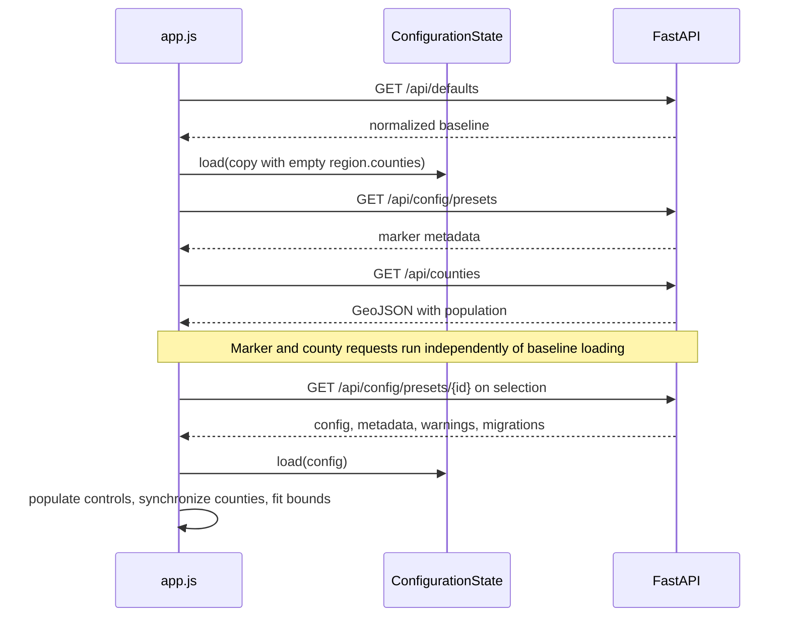

# Webapp guide

This document explains the implementation and the contracts to preserve when changing it. See the [README](../README.md) for installation, running the app, wizard usage, and registering an experiment.

## Architecture and runtime boundaries

FastAPI serves both the API and the static frontend from one process. `run.py` starts `backend.main:app` with development reload enabled. In `main.py`, API routes are registered before the static mount at `/`, so the mount does not intercept them. CORS permits the localhost and loopback origins on port 8000, GET/POST, and the Content-Type request header.

`index.html` loads Leaflet, then `config-state.js` and `app.js` as ordinary scripts. Their top-level bindings share the page's script environment; there is no module bundler or frontend build process. Leaflet, fonts, and map tiles are external resources, while county geometry is served locally.

The browser owns editable state and the downloaded file. The backend reads configuration sources and prepares responses; configuration loading/export does not write those sources. County-data preparation is the separate path that writes disk caches. No endpoint launches a simulation or persists a draft.

## Module responsibilities

| File | Responsibility |
| --- | --- |
| `webapp/run.py` | Development server launcher. |
| `webapp/backend/main.py` | FastAPI endpoints, county-data preparation, and static frontend hosting. |
| `webapp/backend/preset_service.py` | Registered experiment metadata, marker coordinates, public preset responses, and warnings. |
| `webapp/backend/config_service.py` | Configuration loading, normalization, compatibility migrations, structural validation, and export preparation. |
| `webapp/frontend/index.html` | Eight wizard panels and their controls. |
| `webapp/frontend/css/style.css` | Wizard, map, popup-list, and review styling. |
| `webapp/frontend/js/config-state.js` | Complete configuration state, field bindings, snapshots, and survey toggling. |
| `webapp/frontend/js/app.js` | Navigation, map interactions, configuration selection, control events, review, and download. |
| `config/config_local.json` | Maintained baseline used for custom configurations. |
| `examples/<preset-id>/config_used.json` | Experiment snapshots. A folder that also has `config.xml` is a preset. |

Paths in this guide are relative to the repository root unless stated otherwise.

## Browser initialization and selection flow

The `DOMContentLoaded` handler in `app.js` wires navigation, control events, and the review subscription, then starts configuration loading. `initMap()` starts independently when Leaflet is available.



`setupConfiguration()` retains the fetched baseline in `baselineConfig`. `selectPreset({id: 'custom'})` clones it and empties `region.counties` before calling `configuration.load()`. This makes the empty selection part of the custom configuration's original snapshot. `btnNext0` is enabled only after a configuration and counties are present.

`setupExperimentMarkers()` groups metadata into a `Map` keyed by region. Each marker popup contains a title and a native button list. Button handlers call the existing `selectPreset()` function; there is no separate picker state.

For a new experiment selection, `selectPreset()` checks for edits against `selectedSnapshot`, requests confirmation if replacing edits, and fetches the preset. On success it stores the preset warnings and `data_dir_replaced`, loads state, seeds absent-survey templates from the baseline, populates controls, updates the selected-experiment label, and fits county bounds. It returns `'selected'`, `'same'` (already selected), or `null` (cancelled or failed).

A pin popup button calls `choosePresetFromMap()`: it closes the popup, calls `selectPreset()`, and on success shows a toast at the top of the page ("Example selected: … Its counties and parameters are applied."). `showToast(message, kind)` shows the fixed `#toast` element for 4 seconds; load failures use the error style. The "Start a custom configuration instead" button also confirms with a toast.

`updateExperimentLabel()` compares the current counties with the preset's counties. When they differ, the label says that the configuration is based on the experiment and that its calibrated settings may not fit the new area. While a preset is selected, `btnCustomConfiguration` lets the user return to a new custom configuration (with the same edit confirmation).

`presetRequest` is incremented for selections. A response only loads state when its request ID still matches, preventing a slower earlier request from replacing a newer choice. Selecting the currently loaded ID cancels another pending selection, retains edits, and fits the current selection. Loading failures retain the prior configuration and display `configurationStatus`; baseline failures expose a retry button.

### County geometry and configuration synchronization

`selectedCounties` is a map-display lookup keyed by GEOID, containing name, population, and geometry. `configuration.config.region.counties` is the configuration value that is exported. Keep the two update paths distinct:

| Function | Direction and side effects |
| --- | --- |
| `syncSelectedRegion()` | Reads county IDs from configuration, rebuilds display metadata, restyles polygons, and updates tags/statistics. It does not rewrite configuration or county order. |
| `toggleCounty()` / `removeCounty()` | Change the display selection and call `updateRegionSelection()`. |
| `updateRegionSelection()` | Writes the selected GEOIDs through `configuration.set()` and updates Next availability. |
| `fitSelectedRegion()` | Collects matching county layers and fits their bounds with padding and `maxZoom: 9`. |

County geometry can arrive after an experiment is selected. `initMap()` therefore calls `syncSelectedRegion()` after adding the county layer and fits an already selected preset. `updateCountyVisibility()` shows polygons at zoom 6 or above. Returning to the region panel invalidates Leaflet's size after the panel becomes visible and fits the selection.

### Navigation contract

`STEPS` is the ordered panel list. Its indexes must agree with HTML `data-step` values and the `btnNextN`/`btnBackN` IDs used by `setupNavigation()`. The progress bar is sticky: it stays under the sticky header while the page scrolls. `updateStickyOffsets()` writes the header and bar heights to `--header-height` and `--steps-height` (on load and resize); panels use them as `scroll-margin-top`, so a step title is not hidden under the bar. Hover on a step shows a primary-color outline, underlined label and a "Go to …" tooltip. Every tab in the progress bar is clickable in both directions. `goToStep()` moving forward validates the current step and each step in between (`validateStep(i, {quiet: true})` for steps not on screen); it stops on the first invalid step and shows it with its message. Moving back never blocks. `showStep()` toggles panels, updates progress, and focuses the new heading.

`completedSteps` holds the steps that passed validation. They stay green when the user goes back to an earlier tab; a step that fails a later check loses its green state. Review is marked completed only after a successful export, and any configuration change after that clears it. Selecting a new starting configuration clears the set.

`validateStep()` checks edited controls using browser validity rules. Region additionally requires a selected county; Surveys requires an entry with positive general weight or a positive role weight. Review rendering is local and makes no preparation/validation request.

## Frontend state and bindings

`ConfigurationState` owns two independent copies:

- `config`: the current editable configuration.
- `original`: the configuration as loaded, used for review comparisons.

`load()` and `snapshot()` use `structuredClone()`. `set(path, value)` updates one field and notifies subscribers; the review subscriber clears previous export diagnostics and invalidates pending responses.

`CONFIG_BINDINGS` maps control IDs to arrays of JSON keys. For example:

```javascript
'sim-flow_capacity': ['matsim', 'configurable_params', 'qsim.flowCapacityFactor']
```

The dotted MATSim name is one literal key. Do not split it at periods.

`populateConfiguration()` reads state into controls. Population does not dispatch ordinary edit events, so merely displaying an example does not overwrite its values with HTML defaults. Missing fields stay missing until explicitly edited. Numeric, checkbox, and string inputs are converted by `inputValue()` when users change them.

Surveys have dedicated bindings because they live in an array. The current UI addresses the first NHTS entry and the first non-NHTS entry. Disabling a survey caches its object and array position; re-enabling restores it. Baseline survey templates are used only when explicitly adding an absent source. Survey roles and fields not exposed by the UI are retained.

Review helpers compute field differences and hide credential-like keys, private URLs, metadata, and execution-only fields from displayed values. Hiding a value in the review does not remove it from browser state or export. Separately, preset responses redact credential values on the backend before sending them to the browser.

Edits live in memory only. There is no local-storage persistence or server-side draft save; reloading the page starts again from the custom baseline.

## Review and export lifecycle

`renderReview()` compares `configuration.original` against `configuration.config` ("Your changes") and calls `renderReviewChecks()` ("Check before you run"). The checks are: the data folder (always, with the replaced server path for a preset), the resource problems from `resourceProblems()`, and the preset and export warnings (absolute paths, removed credentials). The comparison is against the normalized, public configuration received by the browser, not the raw source file. `configDifferences()` recursively compares objects; arrays are treated as whole changed values.

`renderChangeTable()` shows the differences as a table that needs no clicks: Setting (the name of the wizard field from `settingInfo()`, its step, and the config key), Starting value, and Your value. `displayValue()` writes short values: On/Off for booleans, county names for `region.counties`, type and weight for `data.surveys`, compact JSON for other objects, with credentials hidden. Rows are sorted by wizard step.

The "Check before you run" lines are short: the data folder line (blue) and one warning line (amber) for each resource problem or preset/export warning. Each resource line names the step where the value is.

`setupReview()` subscribes `invalidateReview()` to state changes. That function increments `reviewRequest`, clears export errors, renders the checks again from the current values, and enables export when a configuration exists. The page has no separate validation controls or original-experiment notes.

`exportConfig()` performs these operations:

1. Temporarily disable Export and check edited input validity, including controls outside the current panel.
2. Take a complete configuration snapshot and serialize its fingerprint.
3. POST that object directly to `/api/export`.
4. Ignore the result if the request counter or current configuration fingerprint changed while awaiting the response.
5. On failure, display the backend error in `reviewErrors`.
6. On success, add the `X-Config-Issues` header issues to the checks (without duplicates), then download the returned JSON through a temporary Blob URL.
7. Restore button availability for the current request so errors can be retried.

Preparation does not silently replace the editable state. Export-time automatic differences compare the submitted snapshot with the backend result; the downloaded file contains the backend result. There is no call to `/api/config/prepare` in this browser flow.

### Validation ownership

Browser validity prevents invalid edited controls from being exported even when their invalid draft was not committed into state. Backend `validate_structure()` remains authoritative for the supported configuration contract and runs on export. Portability issues are diagnostics, not proof that a simulation can run. Input files, Java, and detailed engine semantics belong to execution-host validation.

### Computer resources

The resource values are wizard fields in their sections: `plan_generation.num_processes` (Travel Demand), `matsim.pt2matsim.numOfThreads` (Transit, pt2matsim advanced), and `matsim.heap_size_gb`, `matsim.network_heap_size_gb`, `matsim.heap_ram_fraction`, `global.numberOfThreads`, `qsim.numberOfThreads` (Simulation, Computer Resources).

`loadHostInfo()` reads `GET /api/host` (`os.cpu_count()` and psutil RAM of the computer where the web app runs). `resourceProblems()` reports a thread/process value above the CPU count, and a Java memory value above the engine's limit: `max(2, floor(RAM × heap_ram_fraction))`, with the fraction clamped to 0.1–0.9 and 0.7 by default, the same rule as `MATSimRunner._clamp_heap_to_ram`. Unset memory values use the engine defaults (32 GB simulation, 8 GB network). When RAM is unknown, only values of 64 GB or more are reported. `updateResourceHints()` shows the limit or the problem under each field on every state change.

## Backend endpoints

| Method and route | Purpose and response |
| --- | --- |
| `GET /api/counties` | County GeoJSON with population merged into feature properties. |
| `GET /api/defaults` | Fresh normalized baseline configuration. |
| `GET /api/config/presets` | `{presets: [...]}` with metadata, locations, characteristics, warnings, and `data_dir_replaced`, without complete configurations. |
| `GET /api/host` | `{cpus, ram_gb}` of the computer where the web app runs; `ram_gb` is null without psutil. |
| `GET /api/config/presets/{preset_id}` | One preset's metadata plus its complete public configuration. |
| `POST /api/config/prepare` | Prepare a source/configuration envelope and return `{config, issues, migrations}`; retained for API callers, unused by the current frontend. |
| `POST /api/export` | Validate/normalize a submitted configuration and return the engine JSON. Diagnostics are also supplied in `X-Config-Issues` and `X-Config-Migrations` headers. |
| `GET /api/examples` | Existing discovery endpoint listing example directories containing `config_used.json`; the marker UI uses the curated presets endpoint instead. |

Unknown preset IDs return 404. A registered preset that cannot load returns a generic 500 message from the detail endpoint; the list endpoint skips it (with a server log warning) so the other markers still show. Invalid configuration submissions return 422; malformed export JSON returns 400. The frontend's `fetchJSON()` turns failed responses into errors handled by the loading/selection flow. Export handles its response separately and writes failures into `reviewErrors`.

Existing backend compatibility remains: prepare/export also accept supported source envelopes and legacy partial wizard payloads. Legacy exports receive a deprecation diagnostic. The current browser sends a complete configuration for export and does not rely on partial baseline assembly.

### Preset service

There is no hard-coded preset list. `preset_ids(root)` scans `examples/` on each request and returns every folder that has both `config_used.json` and `config.xml`. Only IDs from this scan are accepted, so a client cannot supply a path. Instructions for authors are in the [README](../README.md#adding-an-experiment-to-the-map).

`example_metadata()` derives the display data from the example itself: the region from the README title (text before ` experiment` or the first ` — `, else the folder name), the description from the first README paragraph, the date from the `YYYYMMDD` folder suffix, and the button label from the main survey (first survey with weight above zero) and the date.

The pin location comes from `PresetService(..., locate=...)`. `main.locate_counties()` returns the population-weighted mean of the county centroids (computed in EPSG:5070) for `region.counties`, using the cached county GeoJSON and population files. It returns `None` when no county is known (for example, before the county cache exists). MATSim `config.xml` cannot be used for this: it holds only a UTM `coordinateSystem`, which fixes a longitude band, not a place.

The frontend excludes presets with a null location before grouping entries by the exact region string. Each marker uses the first remaining entry's coordinates. A preset without coordinates is excluded from popup lists as well; it never borrows another preset's location.

`PresetService.load()` calls the configuration service, redacts credential values (help annotations such as `_census_api_key_help` and `YOUR_..._KEY` placeholders are kept, so the user can see what to fill in), replaces the example's `data.data_dir` (a path on the computer where it was run) with the `data_dir` of `config/config_local.json` (`../data` if that file cannot be read), and returns source metadata, survey/scaling characteristics, warnings, and `data_dir_replaced: {from, to}`. Warnings are only absolute paths that remain after the replacement and removed credentials. `list()` obtains this same information but omits the complete configuration; it loads the registered sources rather than returning a separate hardcoded metadata-only catalog.

### Configuration service

`ConfigService` keeps configuration logic separate from HTTP handling. Its important rules are:

- Custom configurations start from `config/config_local.json`.
- Historical examples start from their own saved configuration. They do not inherit unrelated values from today's baseline.
- Recursive merges copy dictionaries; arrays, scalar values, and null replace whole values.
- Unknown engine fields and annotations are preserved.
- Known execution state is removed, including `_config_dir`, `_demand_budget`, generated MATSim survey fields, and derived UTM information when county selection is present.
- A missing engine key stays missing; no value is inferred. The only migration copies legacy `network.counties` to `region.counties`.
- Portability checks report only absolute paths, which usually belong to another computer. Relative paths are normal and are not reported. `is_absolute_path()` detects both POSIX and Windows absolute paths on any host (on Windows, `Path('/media/x').is_absolute()` is false).

Structural validation checks required object sections, county GEOIDs or a network polygon, survey structures, selected booleans and numeric settings, MATSim mode, iterations, capacity factors, and finite numbers. It is not a complete simulation preflight.

`check_execution_readiness()` is a separate opt-in service method for basic host checks. The browser's prepare/export endpoints do not invoke it. A successful download does not prove that survey files, networks, freight inputs, Java, memory, or CPU resources are ready on the execution machine.

### County preparation and caching

`startup()` runs `build_county_geojson()` followed by `build_population_lookup()`. Each returns immediately when its cache file exists; there is no age-based refresh. `build_county_geojson()` derives GEOID from `STATEFP + COUNTYFP`, simplifies geometry with tolerance `0.005` and topology preservation, converts land area to square miles, and writes the selected columns. `/api/counties` reads the cached geometry and joins population by GEOID on each request rather than persisting the joined response.

GeoJSON features include five-digit `GEOID`, state/county codes, name, area, geometry, and population added by `/api/counties`. Existing caches are reused. If the population request fails, the backend writes an empty lookup and county populations display as zero; it does not block selection. A shapefile/geometry preparation failure can prevent startup. If county loading fails in the browser, the map displays an error message.

## Changing and verifying the implementation

For a setting that maps directly to one configuration leaf, add the HTML control and its `CONFIG_BINDINGS` entry. Existing population/event handling should read and write it. Use dedicated handlers for array membership or values such as target-plan mode that do not have a direct one-control/one-value mapping. Preserve unrelated fields and avoid dispatching user edit events during population.

Keep navigation changes synchronized between `STEPS` and the HTML IDs. Keep configuration loading, validation, and export compatibility in `ConfigService`; map code should only select/load configurations and synchronize county display.

Run the relevant regression tests from the repository root:

```bash
.venv/bin/python -m pytest \
  tests/smoke/test_config_export.py \
  tests/smoke/test_config_service.py \
  tests/smoke/test_config_presets_api.py -q
```

| Test file | Main contracts covered |
| --- | --- |
| `test_config_service.py` | Baseline/example isolation, copy/merge rules, runtime-field removal, migrations, structural checks, and diagnostic contracts. |
| `test_config_presets_api.py` | Automatic discovery and metadata, pin locations, survey variants, full preset responses, invalid IDs, credential redaction, and source-load errors. |
| `test_config_export.py` | Complete configuration preservation, one-field edits, unknown values, invalid submissions, legacy compatibility, and source-file integrity. |

There is currently no frontend test harness or Node package manifest. Backend tests do not exercise the DOM or live Leaflet rendering. After changing UI behavior, check custom selection, shared-region popup lists, preset loading before/after county data, highlighting/zoom, replacement confirmation, the popup closing and the selection toast, navigation, invalid controls, failed export/retry, and the downloaded JSON. Verify unexposed source fields remain present.

For JavaScript syntax checks, an available Node executable can run `node --check webapp/frontend/js/app.js` and `node --check webapp/frontend/js/config-state.js`; no package installation is needed.
